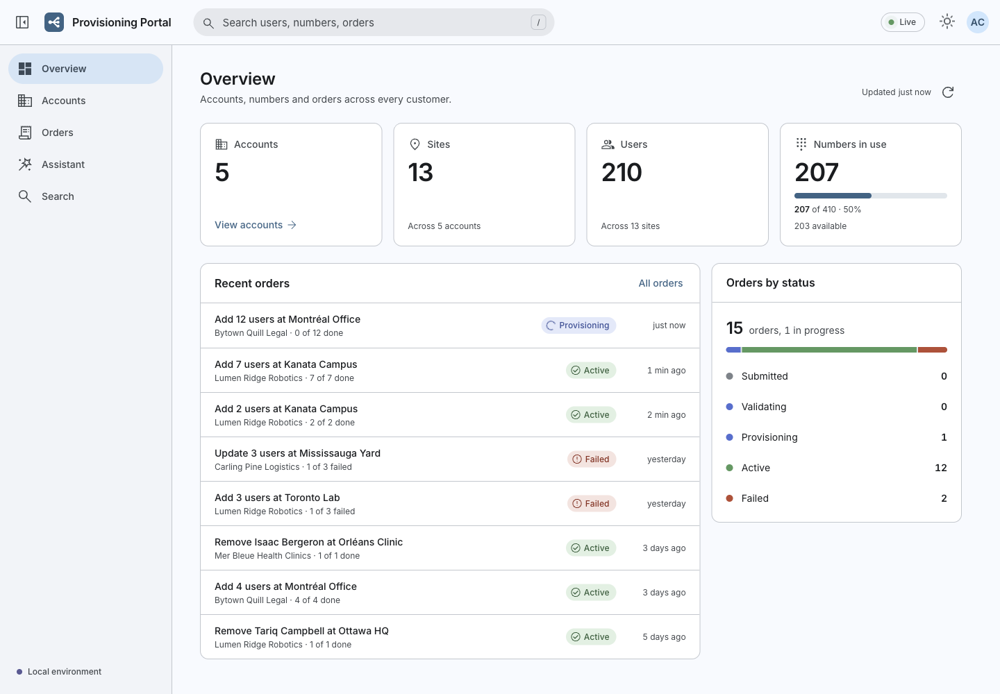
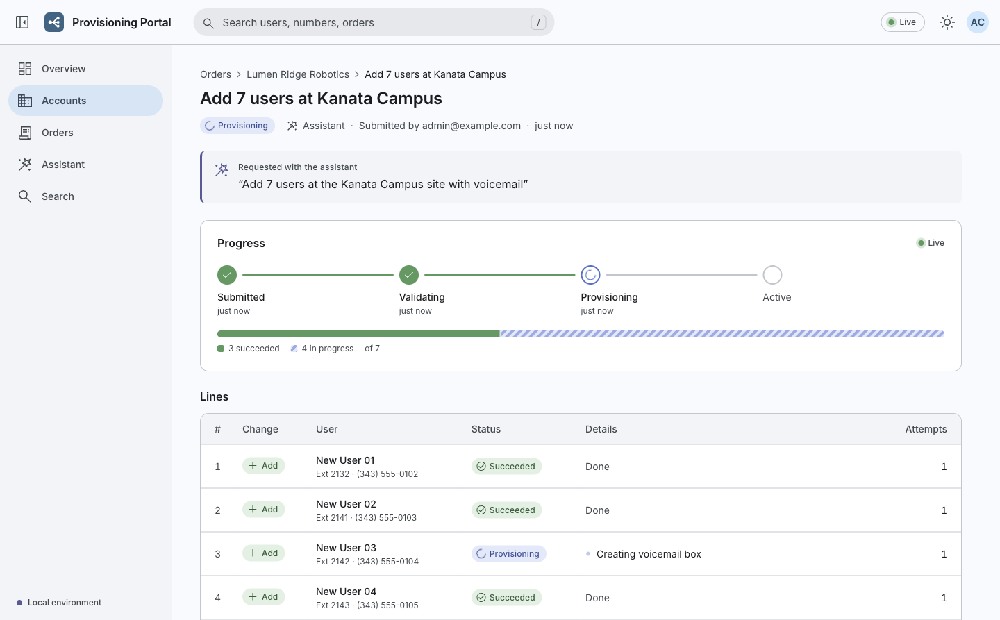
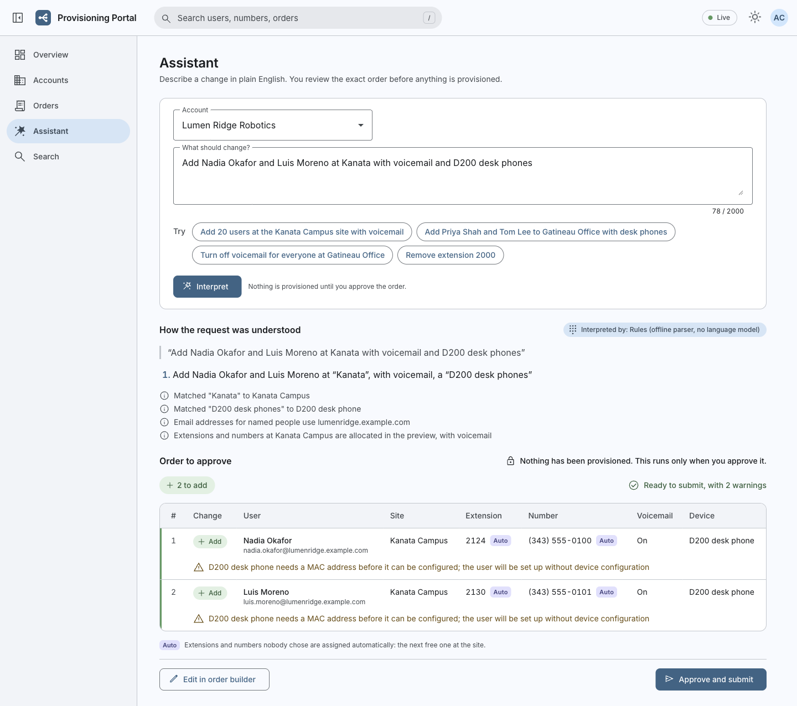
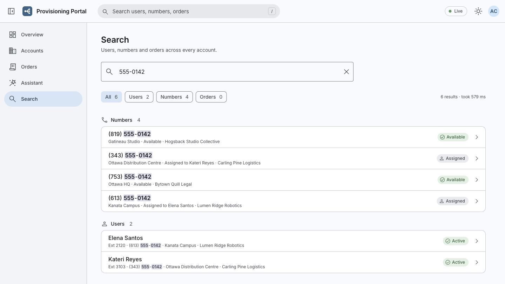
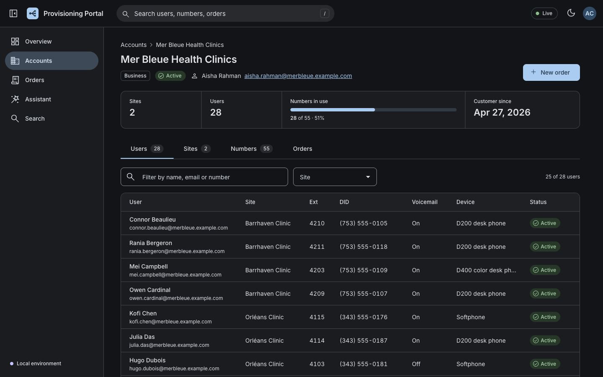
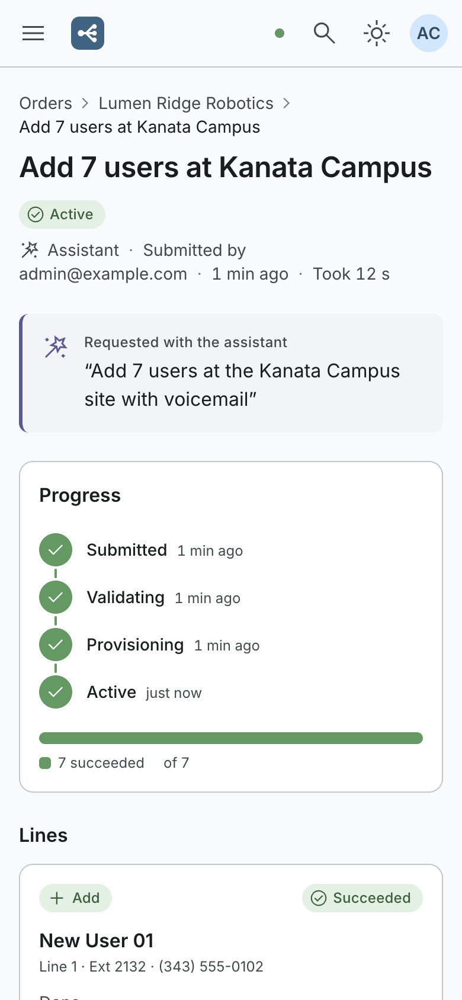

# Provisioning Portal

A service delivery portal for a cloud phone (UCaaS) provider. Operators browse
customer accounts, sites, users and phone numbers, and add, change or remove
users through orders. An order is previewed and validated before it is
submitted, then provisioned by an AWS Step Functions workflow while the page
shows each line's progress live. Orders can also be described in plain
English: Claude turns the request into a structured intent, and the same
deterministic preview a manual order gets shows exactly what will change
before anyone approves it. All data in the project is fictional.



| An order provisioning live                       | The assistant's preview                                   |
| ------------------------------------------------ | --------------------------------------------------------- |
|  |       |
| Search across users, numbers and orders          | Dark theme                                                |
|  |  |



## Stack

- Web: Angular 22 (standalone components, signals, `httpResource`) and
  Angular Material.
- API: Node.js 22 and TypeScript on AWS Lambda, API Gateway (REST and
  WebSocket), Step Functions, DynamoDB (single table with streams),
  OpenSearch and Cognito.
- Assistant: Claude through Amazon Bedrock or the Claude API, with an offline
  rules parser for local development and CI.
- Contract: Zod schemas in `packages/contracts`, shared by the API and the app.
- Infrastructure: AWS CDK in TypeScript, deployed by GitHub Actions.
- Tests: Vitest, Playwright and axe-core.

## Architecture

The Angular app is served from S3 through CloudFront and talks to a REST API
and a WebSocket API. One Lambda serves every REST route. Placing an order
stores it in DynamoDB and starts a Step Functions execution that validates
the order, claims its resources with conditional writes, provisions the lines
in parallel with retries and finalizes it. The table's stream feeds two
consumers: one keeps the OpenSearch index current, the other pushes order
updates to subscribed browsers over the WebSocket API. The language model only
returns an intent; validation, allocation and the decision to submit stay in
deterministic code and with the person.

The phone system behind the orders (carrier, call server, device
configuration) is simulated, with realistic delays and failures.

[docs/detailed-design.md](docs/detailed-design.md) has the diagrams, the data
model and access patterns, the API contract, the order lifecycle and the
trade-offs.

## Running it locally

Needs Node.js 22 and Docker.

```bash
npm ci
docker compose up -d                        # DynamoDB Local :8000, OpenSearch :9200
npm run start:local -w @provisioning/api    # API + WebSocket harness, seeds demo data
npm start -w @provisioning/web              # http://localhost:4200
```

Sign in with `admin@example.com` / `portal-demo`. The harness runs the real
Lambda handlers with local stand-ins for API Gateway, Cognito and Step
Functions. The assistant uses the rules parser unless
`ASSISTANT_PROVIDER=anthropic` and `ANTHROPIC_API_KEY` are set. Add
`-- --reset` to the harness command to drop the data and reseed.

## Tests and CI

```bash
npm run lint && npm run typecheck
npm test                                         # unit tests, every workspace
npm run test:integration -w @provisioning/api    # against DynamoDB Local and OpenSearch
npm run e2e                                      # Playwright, desktop and phone
```

CI runs lint, typecheck, unit tests, build, the integration tests, CDK synth
and the Playwright suite (including axe accessibility scans in light and dark
themes) on every pull request. What is tested at which level, and what is
deliberately not, is in [docs/test-plan.md](docs/test-plan.md).

## Deployment

The CDK app deploys the whole portal as one stack. GitHub Actions deploys
`main` after CI passes, signing in to AWS with OIDC, so no AWS keys are stored
in the repository. There is no public demo running at the moment; setup, cost
and teardown are described in [docs/deployment.md](docs/deployment.md).

## How it was built

The project was built with Claude Code agents working in parallel lanes, each
in its own git worktree, one GitHub issue per pull request, with a human
reviewing the outcome. [CLAUDE.md](CLAUDE.md) is the working agreement the
agents follow.
