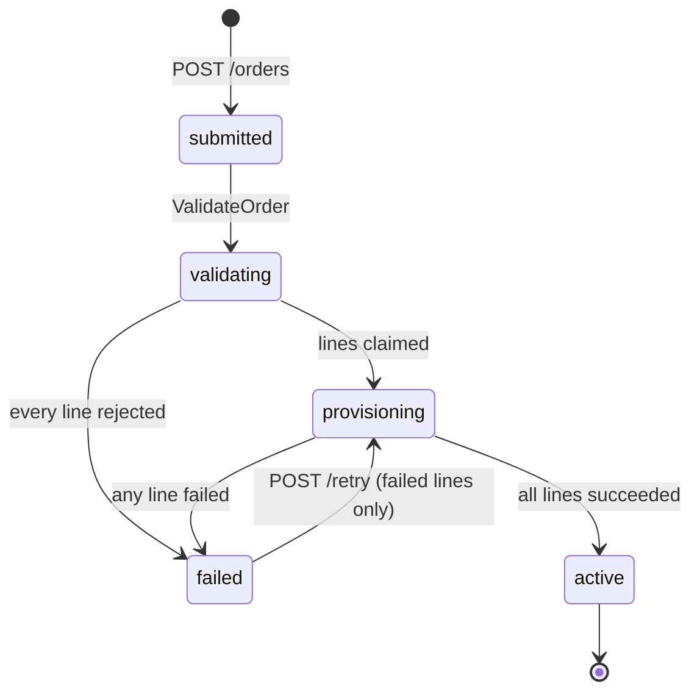
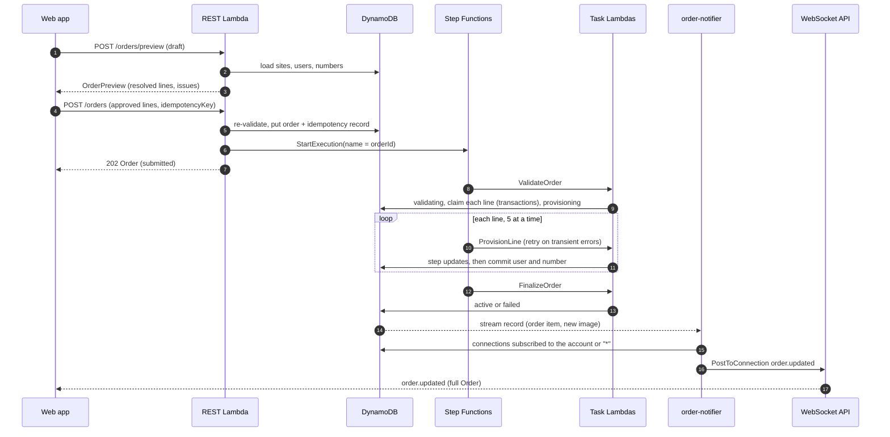

# Detailed design

How the provisioning portal is built. Each section is kept in step with the
code in the PR that changes it.

## Architecture overview

TODO (architecture lane): components, request paths, and a diagram.

## Data model and access patterns

All state lives in one DynamoDB table (on-demand capacity, streams with
`NEW_AND_OLD_IMAGES`). The definition is exported as `TABLE_DEFINITION` from
`services/api/src/data/table.ts`; CDK mirrors it and the local harness and
integration tests create the table from `createTableInput()`.

### Keys and indexes

| Attribute                | Purpose                                                                                        |
| ------------------------ | ---------------------------------------------------------------------------------------------- |
| `PK`, `SK`               | Primary key. Everything that belongs to a customer lives in the `ACCOUNT#<id>` partition.      |
| `GSI1PK`, `GSI1SK`       | GSI1, "list within a scope": accounts by name, an account's users by name, all orders by time. |
| `GSI2PK`, `GSI2SK`       | GSI2, "narrow by site or status": a site's users and numbers, orders with one status.          |
| `entity`                 | Item type (`Account`, `Site`, `User`, ...). Stream consumers filter on it.                     |
| `expiresAt`              | TTL in epoch seconds (WebSocket connections, subscriptions, idempotency records).              |
| `version` (orders)       | Optimistic-locking counter for concurrent workflow updates to one order.                       |
| `pendingOrderId` (users) | Lock held by the in-flight order that is changing or removing the user.                        |

Both GSIs project all attributes. Every key is a string. Key builders live in
`services/api/src/data/keys.ts`; nothing else concatenates key strings.

### Item types

| Entity       | PK                    | SK                           | GSI1PK / GSI1SK                              | GSI2PK / GSI2SK                 |
| ------------ | --------------------- | ---------------------------- | -------------------------------------------- | ------------------------------- |
| Account      | `ACCOUNT#<id>`        | `ACCOUNT`                    | `ACCOUNTS` / `<name>#<id>`                   |                                 |
| Site         | `ACCOUNT#<id>`        | `SITE#<siteId>`              |                                              |                                 |
| User         | `ACCOUNT#<id>`        | `USER#<userId>`              | `ACCOUNT#<id>#USERS` / `<last>#<first>#<id>` | `SITE#<siteId>#USERS` / same    |
| Number       | `ACCOUNT#<id>`        | `NUMBER#<e164>`              | `ACCOUNT#<id>#NUMBERS` / `<status>#<e164>`   | `SITE#<siteId>#NUMBERS` / same  |
| Order        | `ACCOUNT#<id>`        | `ORDER#<orderId>`            | `ORDERS` / `<orderId>`                       | `ORDERS#<status>` / `<orderId>` |
| Guard        | `ACCOUNT#<id>`        | `EMAIL#<email>`, `EXT#<ext>` |                                              |                                 |
| Guard        | `MAC#<mac>`           | `MAC`                        |                                              |                                 |
| Idempotency  | `ACCOUNT#<id>`        | `IDEMPOTENCY#<key>`          |                                              |                                 |
| Connection   | `CONNECTION#<connId>` | `CONNECTION`                 |                                              |                                 |
| Subscription | `CONNECTION#<connId>` | `SUB#<accountId>`            | `SUBSCRIPTION#<accountId>` / `<connId>`      |                                 |

Names in sort keys are lower-cased so lists sort naturally. Order ids are
ULIDs (`ord_01J...`), so sorting by id is sorting by creation time.

Items are the contract objects from `packages/contracts` plus the key
attributes. Reading an item back is a schema parse that strips the keys
(`services/api/src/data/items.ts`), so a stream image or a `GetItem` result
turns into an API object without hand-written mapping.

**Counters.** `Account.userCount`, `numbersAssigned`, `numbersTotal`,
`siteCount` and `Site.userCount`, `numbersAvailable` are stored on the
account and site items and changed in the same transaction as the user or
number they count. `numbersAssigned` counts every number that is not
`available` (assigned or reserved by an in-flight order). `/overview` is a sum
over account items plus one `COUNT` query per order status.

**Uniqueness guards.** DynamoDB has no unique constraints, so a user owns one
guard item per unique value: email and extension within the account, and the
device MAC across all accounts. Guards are written with
`attribute_not_exists(PK)` in the same transaction as the user, which is what
stops two concurrent orders from handing out the same extension.

### Access patterns

| #   | Access pattern                                | Where | Key condition                                                  | Used by                             |
| --- | --------------------------------------------- | ----- | -------------------------------------------------------------- | ----------------------------------- |
| 1   | Get an account                                | table | `PK = ACCOUNT#a`, `SK = ACCOUNT`                               | `GET /accounts/{id}`                |
| 2   | List accounts by name                         | GSI1  | `GSI1PK = ACCOUNTS`                                            | `GET /accounts`, `/overview`        |
| 3   | List an account's sites                       | table | `PK = ACCOUNT#a`, `begins_with(SK, SITE#)`                     | `GET /accounts/{id}/sites`          |
| 4   | Get a site                                    | table | `PK = ACCOUNT#a`, `SK = SITE#s`                                | validation, search indexer          |
| 5   | Get a user                                    | table | `PK = ACCOUNT#a`, `SK = USER#u`                                | workflow tasks                      |
| 6   | List an account's users by last name          | GSI1  | `GSI1PK = ACCOUNT#a#USERS`                                     | `GET /accounts/{id}/users`          |
| 7   | List a site's users by last name              | GSI2  | `GSI2PK = SITE#s#USERS` (filter `accountId`)                   | `GET /accounts/{id}/users?siteId=`  |
| 8   | Every user of an account                      | table | `PK = ACCOUNT#a`, `begins_with(SK, USER#)`                     | order validation context            |
| 9   | List an account's numbers by E.164            | table | `PK = ACCOUNT#a`, `begins_with(SK, NUMBER#)`                   | `GET /accounts/{id}/numbers`        |
| 10  | An account's numbers with one status          | GSI1  | `GSI1PK = ACCOUNT#a#NUMBERS`, `begins_with(GSI1SK, <status>#)` | `GET .../numbers?status=`           |
| 11  | A site's numbers (optionally one status)      | GSI2  | `GSI2PK = SITE#s#NUMBERS`, `begins_with(GSI2SK, <status>#)`    | `GET .../numbers?siteId=&status=`   |
| 12  | Get an order                                  | table | `PK = ACCOUNT#a`, `SK = ORDER#o`                               | `GET .../orders/{id}`, workflow     |
| 13  | An account's orders, newest first             | table | `PK = ACCOUNT#a`, `begins_with(SK, ORDER#)`, descending        | `GET /accounts/{id}/orders`         |
| 14  | An account's orders with one status           | table | as 13, `FilterExpression status = :s`                          | `GET /accounts/{id}/orders?status=` |
| 15  | All orders, newest first                      | GSI1  | `GSI1PK = ORDERS`, descending                                  | `GET /orders`, `/overview`          |
| 16  | All orders with one status; count per status  | GSI2  | `GSI2PK = ORDERS#<status>`, descending                         | `GET /orders?status=`, `/overview`  |
| 17  | Claim an email or extension within an account | table | `PUT PK = ACCOUNT#a, SK = EMAIL#e / EXT#x` if not exists       | order workflow                      |
| 18  | Claim a MAC address                           | table | `PUT PK = MAC#m, SK = MAC` if not exists                       | order workflow                      |
| 19  | Find the order for an idempotency key         | table | `PK = ACCOUNT#a`, `SK = IDEMPOTENCY#k` (TTL 24 h)              | `POST /accounts/{id}/orders`        |
| 20  | A connection and all its subscriptions        | table | `PK = CONNECTION#c`                                            | `$disconnect`, gone connections     |
| 21  | Connections to notify about an account        | GSI1  | `GSI1PK = SUBSCRIPTION#a` and `SUBSCRIPTION#*`                 | `order-notifier`                    |

Notes on the choices:

- **Account orders by status use a filter, not a third GSI.** One account has a
  bounded number of orders; the repository repeats the query (at most five
  round trips) until the page is full, so filtered pages are not short.
- **`ORDERS` is a single GSI1 partition.** Fine at this scale (orders are
  written a few times a minute). At high volume it would be sharded by day
  (`ORDERS#2026-11-21`) and merged when reading.
- **Validation loads an account's users and numbers** (patterns 8 and 9). Order
  rules need "is this extension free", "is this email unique", "which number is
  next"; one query each keeps validation a pure function that is unit-tested
  without DynamoDB. That is cheap for accounts of up to a few thousand users;
  beyond that the guard items would be read directly instead.

### Pagination

List endpoints return `{ items, nextCursor }`. The cursor is the DynamoDB
`LastEvaluatedKey`, JSON-encoded and base64url'd (`data/cursor.ts`). On the way
back in it is decoded, checked to be a flat string map, and checked to belong
to the same partition as the query, so a cursor from one list cannot be
replayed against another. A bad cursor is a `400 bad_request`. `limit` is
1-100 (default 25).

### Seed data

`services/api/src/local/seed` generates the demo dataset deterministically
(seeded PRNG, timestamps relative to "now"): 5 fictional accounts with 2-4
sites each, about 190 users, number inventory drawn only from the 555-0100 to
555-0199 block reserved for fiction across ten Canadian area codes, and an
order history with active and failed orders. Customer email domains are
subdomains of `example.com`. One failed order (Toronto Lab) has a line that
succeeds when retried, for demos.

## API contract

Every payload is defined once, as a Zod schema in `packages/contracts`. The
Lambdas parse requests with those schemas and the web app imports the same
types, so there is no second definition to drift.

### One REST Lambda

All routes are served by one Lambda (`services/api/src/handlers/http.ts`)
behind an API Gateway REST API with a `{proxy+}` resource, proxy integration
and a Cognito user pool authorizer. A small router (`src/http/router.ts`) maps
`METHOD /path/{param}` to handlers; literal segments win over parameters, so
`/orders/preview` is never read as an order id.

Why one function rather than one per route: the routes share almost all of
their code and dependencies (repositories, validation, the contract), cold
starts are paid once instead of per route, and the CDK stack stays small. The
cost is coarser IAM (the function can do everything any route can) and
per-route metrics come from the request log instead of per-function
CloudWatch metrics. Each request writes one structured log line with method,
path, status and duration.

### Routes

| Method | Path                                                    | Body                 | Response            |
| ------ | ------------------------------------------------------- | -------------------- | ------------------- |
| GET    | `/overview`                                             |                      | `Overview`          |
| GET    | `/catalog/devices`                                      |                      | `DeviceCatalog`     |
| GET    | `/search?q=&entity=&accountId=&limit=`                  |                      | `SearchResponse`    |
| GET    | `/accounts?cursor=&limit=`                              |                      | `AccountPage`       |
| GET    | `/accounts/{accountId}`                                 |                      | `Account`           |
| GET    | `/accounts/{accountId}/sites`                           |                      | `SitePage`          |
| GET    | `/accounts/{accountId}/users?siteId=&cursor=`           |                      | `VoiceUserPage`     |
| GET    | `/accounts/{accountId}/numbers?siteId=&status=&cursor=` |                      | `PhoneNumberPage`   |
| GET    | `/accounts/{accountId}/orders?status=&cursor=`          |                      | `OrderSummaryPage`  |
| GET    | `/accounts/{accountId}/orders/{orderId}`                |                      | `Order`             |
| POST   | `/accounts/{accountId}/orders/preview`                  | `OrderDraft`         | `OrderPreview`      |
| POST   | `/accounts/{accountId}/orders`                          | `CreateOrderRequest` | `202 Order`         |
| POST   | `/accounts/{accountId}/orders/{orderId}/retry`          |                      | `202 Order`         |
| POST   | `/accounts/{accountId}/assistant/interpret`             | `InterpretRequest`   | `InterpretResponse` |
| GET    | `/orders?status=&cursor=`                               |                      | `OrderSummaryPage`  |

### Errors

Every non-2xx body is an `ApiError`: `{ "error": { "code", "message", "details"? } }`.

| Status | Code                    | When                                                                                                                            |
| ------ | ----------------------- | ------------------------------------------------------------------------------------------------------------------------------- |
| 400    | `bad_request`           | Body or query fails its schema (`details.issues` lists `{ path, message }`), bad cursor, invalid JSON, wrong method (405)       |
| 401    | `unauthorized`          | No valid token                                                                                                                  |
| 404    | `not_found`             | Unknown route, account or order                                                                                                 |
| 409    | `conflict`              | Retrying an order that is not `failed`; an idempotency key reused for a different order                                         |
| 422    | `validation_failed`     | Order rules fail on create, or a draft refers to a site or user that does not exist (`details.issues` holds `ValidationIssue`s) |
| 502    | `assistant_unavailable` | The language model provider failed or refused                                                                                   |
| 500    | `internal`              | Anything unexpected; `details.requestId` matches the log line                                                                   |

Preview is different on purpose: rule violations in a preview are a `200`
with `valid: false` and the issues, because showing them is the point of a
preview.

### Authentication

In AWS the REST API's Cognito authorizer validates the ID token and puts its
claims on `requestContext.authorizer.claims`; the Lambda reads `sub`, `email`
and `name` from there and rejects a request without them. The WebSocket API
uses a Lambda authorizer (`ws-authorizer.ts`) because browsers cannot set
headers on a WebSocket handshake; the token goes in `?token=`. Locally
(`AUTH_MODE=local`) the harness issues HS256 tokens for demo operators and
plays the authorizer's role. Pagination is described under "Data model".

## Order lifecycle

Lines move `pending -> provisioning -> succeeded | failed`. Users created by an
order show `provisioning` while their line runs (`removing` for removals), then
`active` or `failed`.

### Validation, twice

`POST /orders/preview` resolves a draft (allocates the lowest free extension
in the site's range and the lowest available number at the site) and runs the
order rules. `POST /orders` runs the same rules on the lines the person
approved; nothing is re-allocated, so what was previewed is what is ordered.
The rules (`src/domain/order-validation.ts`) are pure functions over an
`AccountContext`:

- the account is not suspended; at most `MAX_ORDER_LINES` lines;
- the site belongs to the account; the extension is inside the site's range,
  unused, and not repeated in the order;
- the DID is in the account's inventory, at that site, `available`, and not
  repeated;
- the email is unique within the account and the order (warning if it is not
  on the account's domain);
- the device exists in the catalog; a MAC is only given to hardware that takes
  one, is not registered to any other phone and is not repeated (warning when
  hardware has no MAC yet: it is provisioned without device configuration);
- update and remove targets exist, are not locked by another in-flight order,
  are not changed twice in one order, and still match the `before` snapshot
  the person approved; an update can only change voicemail and the device.

### Claims and concurrency

The API's validation reads a snapshot, so two orders submitted at the same
moment can both pass it. The workflow's first task closes that gap:
ValidateOrder re-runs the rules and then claims every line's resources in one
DynamoDB transaction per line: the user item, email and extension guards, the
number (`available -> reserved`, conditional on still being available), the
MAC guard and the account and site counters. If a condition fails, that line
is rejected with a message naming what was taken; the integration tests run
two orders for the same number concurrently and check that exactly one wins.

Orders are updated by several Lambdas at once (up to five lines in parallel),
so every order write is a read-modify-write guarded by a `version` attribute
and retried on conflict. Order creation is idempotent: the client's
`idempotencyKey` is stored with a hash of the request for 24 hours; a repeat
returns the original order, a different request with the same key is a `409`.

### Step Functions

The state machine (Standard workflow) is defined in code in
`src/workflow/definition.ts` (`orderWorkflowDefinition()`), so CDK and the
local runner share one shape:

- **ValidateOrder**: re-validate, claim, reject what cannot be claimed.
- **ProvisionLines**: a Map over the claimed lines, `MaxConcurrency: 5`. Each
  item runs **ProvisionLine** with `PROVISION_LINE_RETRY`
  (`ProvisioningTransientError`, 2 s interval, backoff 2, 2 retries: three
  attempts in total). Any other error, or running out of retries, goes to the
  Catch, which calls the same Lambda as **RecordLineFailure** with the error;
  it marks the line failed and releases its lock.
- **FinalizeOrder**: `active` if every line succeeded, otherwise `failed`. If
  ValidateOrder or the Map itself fails, their Catch also lands here and the
  unfinished lines are failed with an explanation.

ProvisionLine writes the current step to the order before running it, so the
UI shows "Creating voicemail box" while it happens. Every task is safe to run
twice: finished lines are skipped and claims recognise resources the order
already holds.

### Live updates

The web app keeps one WebSocket open (API Gateway WebSocket API, route
selection `$request.body.action`; protocol in `packages/contracts/src/realtime.ts`):

- **$connect** goes through `ws-authorizer.ts`, a Lambda REQUEST authorizer
  that verifies the ID token from `?token=` (browsers cannot set headers on a
  WebSocket handshake) and hands `sub`, `email` and `name` to `ws.ts` as
  context. `ws.ts` stores a connection item with a TTL just over API
  Gateway's two-hour connection limit.
- **subscribe / unsubscribe** `{ action, accountId }` store or delete a
  subscription item; `accountId: "*"` means every account (the all-orders
  view). The server confirms with `{ type: "subscribed" }`. **ping** gets
  `{ type: "pong" }`, which keeps idle connections open (API Gateway closes
  them after 10 idle minutes).
- **order-notifier** consumes the table stream, filtered to order items. The
  new image is the whole order, so it needs no read: for each order in the
  batch (only the latest image of each, so a burst of step updates becomes
  one message) it looks up the subscribers of the order's account plus `*`
  subscribers and calls `PostToConnection` with
  `{ type: "order.updated", order }`. A `GoneException` deletes the
  connection. Delivery is best effort: a failed send is logged and the batch
  is not retried, because a retry would re-send to everyone else; clients
  should re-fetch what they show when they reconnect. An order is capped at
  100 lines so the message stays under API Gateway's 128 KB limit.

### Simulated provisioning

There is no carrier, call server or device configuration service behind this
project. `src/provisioning/simulated-provisioner.ts` implements the
`Provisioner` interface by waiting 1-3 s per step
(`PROVISIONING_STEP_DELAY_MS`) and failing transiently at
`PROVISIONING_TRANSIENT_FAILURE_RATE` (default 0.1 per line attempt). Two
email triggers make failure deterministic for tests and demos:
`name+fail@...` fails permanently with a realistic error and `name+flaky@...`
fails its first attempt transiently, then succeeds. A real integration would
implement the same two methods (`plan`, `runStep`).

### Retry

`POST /accounts/{id}/orders/{orderId}/retry` is accepted only for a `failed`
order. Failed lines go back to `pending`, the order to `provisioning`, and a
new execution runs with `lineIds` limited to those lines. A failed add keeps
its user (status `failed`) and its reserved number in the meantime, so the
retry does not compete for a new number.

### One order, end to end

## Search

`GET /search?q=&entity=&accountId=&limit=` searches users, numbers and orders
in one OpenSearch index (`OPENSEARCH_INDEX`, default `provisioning`).

**One index, `entity` field.** The search box queries everything at once and
ranks it together; one index does that in one request. Separate indexes per
entity would need a multi-search and score merging, and the three document
types share almost all fields anyway. Each document has `entity`, `id`,
`accountId`, `accountName`, `title`, `subtitle`, `status`, `text`, `digits`
and `updatedAt` (`src/search/documents.ts`).

**Mappings** (`src/search/index-definition.ts`, `dynamic: strict`):

| Field      | Type / analyzer                                  | Why                                                     |
| ---------- | ------------------------------------------------ | ------------------------------------------------------- |
| `title`    | `search_as_you_type`, lower-cased, accent-folded | Names and order titles match as you type ("sof")        |
| `subtitle` | text, folded                                     | Extension, formatted number, site                       |
| `text`     | text, split on non-alphanumerics, folded         | Email, site, account, order id, prompt, names in orders |
| `digits`   | 3-11 character n-grams of digit strings          | "0142", "5550142", "+1 613 555 0142" all find a number  |
| others     | keyword / date                                   | Filters and display                                     |

**Query.** `bool_prefix` over the title subfields (boosted), `bool_prefix` over
`subtitle` and `text`, and, when the query has three or more digits, a term
query of just its digits on `digits`. `entity` and `accountId` are filters.

**Highlighting.** OpenSearch wraps matches in two private-use characters; the
API HTML-escapes the fragment and then turns those characters into `<mark>`
and `</mark>`. Names and prompts are user input, so nothing else can survive
as markup. (Control characters do not work as markers: the highlighter trims
fragments with Java's `trim()`, which strips them.)

**Keeping it current.** `search-indexer` consumes the table stream (filtered to
users, numbers and orders, removals included), builds documents (looking up
site, account and user names, cached per batch) and sends one bulk request per
batch with only the last change per document. A failed bulk item fails the
batch so Lambda retries it; index and delete are idempotent. The index is
created with its mappings on first use. `reindexAll()` (`npm run reindex -w
@provisioning/api` locally) rebuilds it from a table scan; the harness runs it
after seeding. Before the index exists `/search` returns no results rather
than an error.

In AWS the client signs requests with SigV4 (`OPENSEARCH_AUTH=sigv4`,
`OPENSEARCH_SERVICE=es` or `aoss`); locally it talks plain HTTP to the
container (`OPENSEARCH_AUTH=none`).

## Assistant

TODO (filled in with #6).

## Local development harness

TODO (filled in with #7).

## Infrastructure

TODO (infrastructure lane).

## Front-end

TODO (web lane).

## Trade-offs

TODO (architecture lane).
