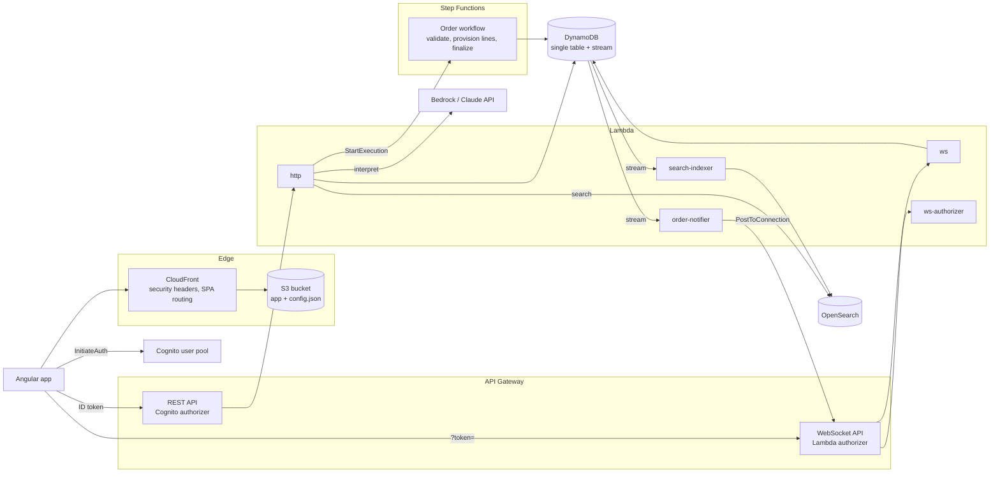
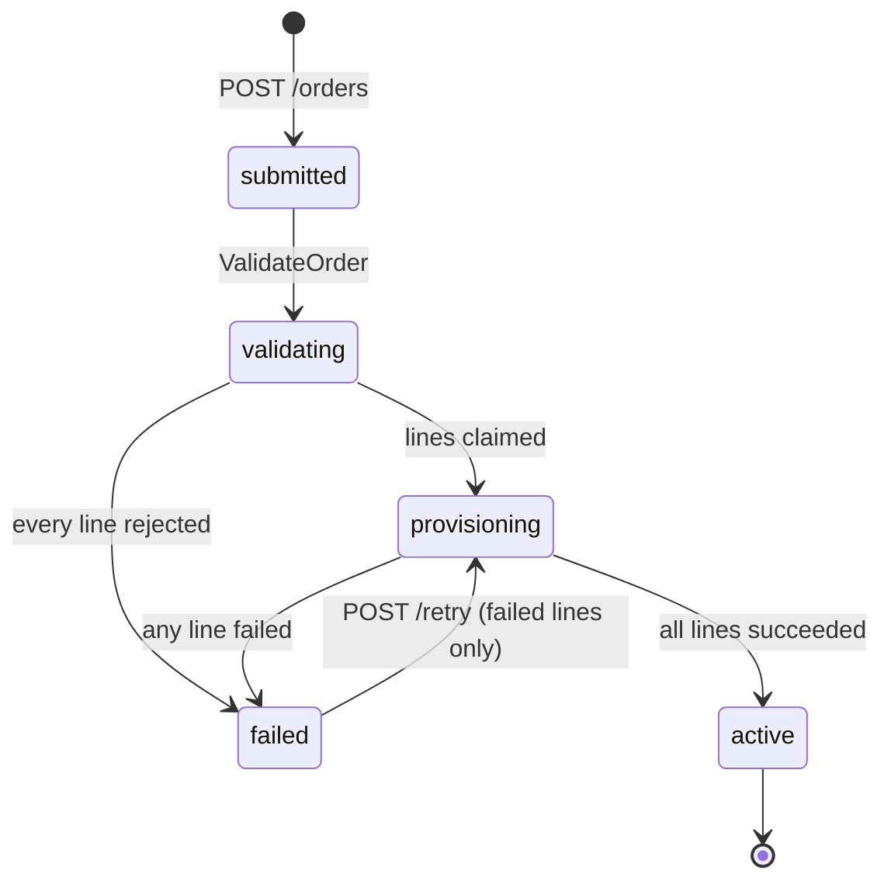
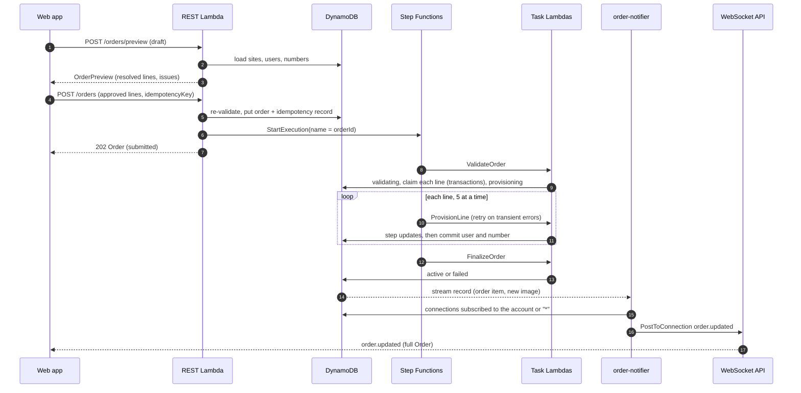
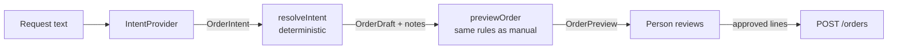

# Detailed design

How the provisioning portal is built. Each section is kept in step with the
code in the PR that changes it.

## Architecture overview

A single-page Angular app served from CloudFront talks to two API Gateway
APIs: a REST API for reads and commands, and a WebSocket API that pushes order
updates. Everything behind them is serverless and pay-per-use except the
OpenSearch domain. All state lives in one DynamoDB table; its stream feeds the
search index and the live updates, so neither is written to directly by the
request path.

| Path            | Flow                                                                                                   |
| --------------- | ------------------------------------------------------------------------------------------------------ |
| Sign-in         | The app calls Cognito `InitiateAuth` (`USER_PASSWORD_AUTH`) and keeps the ID token.                    |
| Reads           | REST API (Cognito authorizer) -> `http` Lambda -> DynamoDB, or OpenSearch for `/search`.               |
| Placing orders  | `POST /orders` validates, stores the order and starts a Step Functions execution; the API returns 202. |
| Provisioning    | The state machine runs the three workflow Lambdas, which write progress to the order item.             |
| Live updates    | Order writes reach `order-notifier` through the table stream; it pushes them to subscribed WebSockets. |
| Search indexing | User, number and order writes reach `search-indexer` through the same stream.                          |
| Assistant       | `http` asks Claude (Bedrock or the Claude API) for an intent only; the preview is deterministic code.  |

The same handlers run locally behind stand-ins for each AWS service (see
"Local development harness"), and the CDK app in `infra/` deploys them
(see "Infrastructure").

## Data model and access patterns

All state lives in one DynamoDB table (on-demand capacity, streams with
`NEW_AND_OLD_IMAGES`). The definition is exported as `TABLE_DEFINITION` from
`services/api/src/data/table.ts`; CDK mirrors it and the local harness and
integration tests create the table from `createTableInput()`.

### Keys and indexes

| Attribute                | Purpose                                                                                        |
| ------------------------ | ---------------------------------------------------------------------------------------------- |
| `PK`, `SK`               | Primary key. Everything that belongs to a customer lives in the `ACCOUNT#<id>` partition.      |
| `GSI1PK`, `GSI1SK`       | GSI1, "list within a scope": accounts by name, an account's users by name, all orders by time. |
| `GSI2PK`, `GSI2SK`       | GSI2, "narrow by site or status": a site's users and numbers, orders with one status.          |
| `entity`                 | Item type (`Account`, `Site`, `User`, ...). Stream consumers filter on it.                     |
| `expiresAt`              | TTL in epoch seconds (WebSocket connections, subscriptions, idempotency records).              |
| `version` (orders)       | Optimistic-locking counter for concurrent workflow updates to one order.                       |
| `pendingOrderId` (users) | Lock held by the in-flight order that is changing or removing the user.                        |

Both GSIs project all attributes. Every key is a string. Key builders live in
`services/api/src/data/keys.ts`; nothing else concatenates key strings.

### Item types

| Entity       | PK                    | SK                           | GSI1PK / GSI1SK                              | GSI2PK / GSI2SK                 |
| ------------ | --------------------- | ---------------------------- | -------------------------------------------- | ------------------------------- |
| Account      | `ACCOUNT#<id>`        | `ACCOUNT`                    | `ACCOUNTS` / `<name>#<id>`                   |                                 |
| Site         | `ACCOUNT#<id>`        | `SITE#<siteId>`              |                                              |                                 |
| User         | `ACCOUNT#<id>`        | `USER#<userId>`              | `ACCOUNT#<id>#USERS` / `<last>#<first>#<id>` | `SITE#<siteId>#USERS` / same    |
| Number       | `ACCOUNT#<id>`        | `NUMBER#<e164>`              | `ACCOUNT#<id>#NUMBERS` / `<status>#<e164>`   | `SITE#<siteId>#NUMBERS` / same  |
| Order        | `ACCOUNT#<id>`        | `ORDER#<orderId>`            | `ORDERS` / `<orderId>`                       | `ORDERS#<status>` / `<orderId>` |
| Guard        | `ACCOUNT#<id>`        | `EMAIL#<email>`, `EXT#<ext>` |                                              |                                 |
| Guard        | `MAC#<mac>`           | `MAC`                        |                                              |                                 |
| Idempotency  | `ACCOUNT#<id>`        | `IDEMPOTENCY#<key>`          |                                              |                                 |
| Connection   | `CONNECTION#<connId>` | `CONNECTION`                 |                                              |                                 |
| Subscription | `CONNECTION#<connId>` | `SUB#<accountId>`            | `SUBSCRIPTION#<accountId>` / `<connId>`      |                                 |

Names in sort keys are lower-cased so lists sort naturally. Order ids are
ULIDs (`ord_01J...`), so sorting by id is sorting by creation time.

Items are the contract objects from `packages/contracts` plus the key
attributes. Reading an item back is a schema parse that strips the keys
(`services/api/src/data/items.ts`), so a stream image or a `GetItem` result
turns into an API object without hand-written mapping.

**Counters.** `Account.userCount`, `numbersAssigned`, `numbersTotal`,
`siteCount` and `Site.userCount`, `numbersAvailable` are stored on the
account and site items and changed in the same transaction as the user or
number they count. `numbersAssigned` counts every number that is not
`available` (assigned or reserved by an in-flight order). `/overview` is a sum
over account items plus one `COUNT` query per order status.

**Uniqueness guards.** DynamoDB has no unique constraints, so a user owns one
guard item per unique value: email and extension within the account, and the
device MAC across all accounts. Guards are written with
`attribute_not_exists(PK)` in the same transaction as the user, which is what
stops two concurrent orders from handing out the same extension.

### Access patterns

| #   | Access pattern                                | Where | Key condition                                                  | Used by                             |
| --- | --------------------------------------------- | ----- | -------------------------------------------------------------- | ----------------------------------- |
| 1   | Get an account                                | table | `PK = ACCOUNT#a`, `SK = ACCOUNT`                               | `GET /accounts/{id}`                |
| 2   | List accounts by name                         | GSI1  | `GSI1PK = ACCOUNTS`                                            | `GET /accounts`, `/overview`        |
| 3   | List an account's sites                       | table | `PK = ACCOUNT#a`, `begins_with(SK, SITE#)`                     | `GET /accounts/{id}/sites`          |
| 4   | Get a site                                    | table | `PK = ACCOUNT#a`, `SK = SITE#s`                                | validation, search indexer          |
| 5   | Get a user                                    | table | `PK = ACCOUNT#a`, `SK = USER#u`                                | workflow tasks                      |
| 6   | List an account's users by last name          | GSI1  | `GSI1PK = ACCOUNT#a#USERS`                                     | `GET /accounts/{id}/users`          |
| 7   | List a site's users by last name              | GSI2  | `GSI2PK = SITE#s#USERS` (filter `accountId`)                   | `GET /accounts/{id}/users?siteId=`  |
| 8   | Every user of an account                      | table | `PK = ACCOUNT#a`, `begins_with(SK, USER#)`                     | order validation context            |
| 9   | List an account's numbers by E.164            | table | `PK = ACCOUNT#a`, `begins_with(SK, NUMBER#)`                   | `GET /accounts/{id}/numbers`        |
| 10  | An account's numbers with one status          | GSI1  | `GSI1PK = ACCOUNT#a#NUMBERS`, `begins_with(GSI1SK, <status>#)` | `GET .../numbers?status=`           |
| 11  | A site's numbers (optionally one status)      | GSI2  | `GSI2PK = SITE#s#NUMBERS`, `begins_with(GSI2SK, <status>#)`    | `GET .../numbers?siteId=&status=`   |
| 12  | Get an order                                  | table | `PK = ACCOUNT#a`, `SK = ORDER#o`                               | `GET .../orders/{id}`, workflow     |
| 13  | An account's orders, newest first             | table | `PK = ACCOUNT#a`, `begins_with(SK, ORDER#)`, descending        | `GET /accounts/{id}/orders`         |
| 14  | An account's orders with one status           | table | as 13, `FilterExpression status = :s`                          | `GET /accounts/{id}/orders?status=` |
| 15  | All orders, newest first                      | GSI1  | `GSI1PK = ORDERS`, descending                                  | `GET /orders`, `/overview`          |
| 16  | All orders with one status; count per status  | GSI2  | `GSI2PK = ORDERS#<status>`, descending                         | `GET /orders?status=`, `/overview`  |
| 17  | Claim an email or extension within an account | table | `PUT PK = ACCOUNT#a, SK = EMAIL#e / EXT#x` if not exists       | order workflow                      |
| 18  | Claim a MAC address                           | table | `PUT PK = MAC#m, SK = MAC` if not exists                       | order workflow                      |
| 19  | Find the order for an idempotency key         | table | `PK = ACCOUNT#a`, `SK = IDEMPOTENCY#k` (TTL 24 h)              | `POST /accounts/{id}/orders`        |
| 20  | A connection and all its subscriptions        | table | `PK = CONNECTION#c`                                            | `$disconnect`, gone connections     |
| 21  | Connections to notify about an account        | GSI1  | `GSI1PK = SUBSCRIPTION#a` and `SUBSCRIPTION#*`                 | `order-notifier`                    |

Notes on the choices:

- **Account orders by status use a filter, not a third GSI.** One account has a
  bounded number of orders; the repository repeats the query (at most five
  round trips) until the page is full, so filtered pages are not short.
- **The users text filter reads the partition in the service.** `q` matches
  first, last and full name, email, extension and the DID's digits however typed
  (case-insensitive, every term must match). That is not a DynamoDB
  `FilterExpression`, and filter plus `Limit` gives short pages. An account's (or
  site's) users are a bounded partition, so the repository reads the same GSI
  query in chunks of 100, matches in memory and stops when the page is full. The
  cursor is the key of the last user returned, so the next page resumes right
  after it; a page is short only at the end of the list. A search attribute or
  OpenSearch would replace this beyond a few thousand users per account.
- **`ORDERS` is a single GSI1 partition.** Fine at this scale (orders are
  written a few times a minute). At high volume it would be sharded by day
  (`ORDERS#2026-11-21`) and merged when reading.
- **Validation loads an account's users and numbers** (patterns 8 and 9). Order
  rules need "is this extension free", "is this email unique", "which number is
  next"; one query each keeps validation a pure function that is unit-tested
  without DynamoDB. That is cheap for accounts of up to a few thousand users;
  beyond that the guard items would be read directly instead.

### Pagination

List endpoints return `{ items, nextCursor }`. The cursor is the DynamoDB
`LastEvaluatedKey`, JSON-encoded and base64url'd (`data/cursor.ts`). On the way
back in it is decoded, checked to be a flat string map, and checked to belong
to the same partition as the query, so a cursor from one list cannot be
replayed against another. A bad cursor is a `400 bad_request`. `limit` is
1-100 (default 25).

### Seed data

`services/api/src/local/seed` generates the demo dataset deterministically
(seeded PRNG, timestamps relative to "now"): 5 fictional accounts with 2-4
sites each, about 190 users, number inventory drawn only from the 555-0100 to
555-0199 block reserved for fiction across ten Canadian area codes, and an
order history with active and failed orders. Customer email domains are
subdomains of `example.com`. One failed order (Toronto Lab) has a line that
succeeds when retried, for demos.

## API contract

Every payload is defined once, as a Zod schema in `packages/contracts`. The
Lambdas parse requests with those schemas and the web app imports the same
types, so there is no second definition to drift.

### One REST Lambda

All routes are served by one Lambda (`services/api/src/handlers/http.ts`)
behind an API Gateway REST API with a `{proxy+}` resource, proxy integration
and a Cognito user pool authorizer. A small router (`src/http/router.ts`) maps
`METHOD /path/{param}` to handlers; literal segments win over parameters, so
`/orders/preview` is never read as an order id.

Why one function rather than one per route: the routes share almost all of
their code and dependencies (repositories, validation, the contract), cold
starts are paid once instead of per route, and the CDK stack stays small. The
cost is coarser IAM (the function can do everything any route can) and
per-route metrics come from the request log instead of per-function
CloudWatch metrics. Each request writes one structured log line with method,
path, status and duration.

### Routes

| Method | Path                                                    | Body                 | Response            |
| ------ | ------------------------------------------------------- | -------------------- | ------------------- |
| GET    | `/overview`                                             |                      | `Overview`          |
| GET    | `/catalog/devices`                                      |                      | `DeviceCatalog`     |
| GET    | `/search?q=&entity=&accountId=&limit=`                  |                      | `SearchResponse`    |
| GET    | `/accounts?cursor=&limit=`                              |                      | `AccountPage`       |
| GET    | `/accounts/{accountId}`                                 |                      | `Account`           |
| GET    | `/accounts/{accountId}/sites`                           |                      | `SitePage`          |
| GET    | `/accounts/{accountId}/users?siteId=&q=&cursor=&limit=` |                      | `VoiceUserPage`     |
| GET    | `/accounts/{accountId}/numbers?siteId=&status=&cursor=` |                      | `PhoneNumberPage`   |
| GET    | `/accounts/{accountId}/orders?status=&cursor=`          |                      | `OrderSummaryPage`  |
| GET    | `/accounts/{accountId}/orders/{orderId}`                |                      | `Order`             |
| POST   | `/accounts/{accountId}/orders/preview`                  | `OrderDraft`         | `OrderPreview`      |
| POST   | `/accounts/{accountId}/orders`                          | `CreateOrderRequest` | `202 Order`         |
| POST   | `/accounts/{accountId}/orders/{orderId}/retry`          |                      | `202 Order`         |
| POST   | `/accounts/{accountId}/assistant/interpret`             | `InterpretRequest`   | `InterpretResponse` |
| GET    | `/orders?status=&cursor=`                               |                      | `OrderSummaryPage`  |

### Errors

Every non-2xx body is an `ApiError`: `{ "error": { "code", "message", "details"? } }`.

| Status | Code                    | When                                                                                                                            |
| ------ | ----------------------- | ------------------------------------------------------------------------------------------------------------------------------- |
| 400    | `bad_request`           | Body or query fails its schema (`details.issues` lists `{ path, message }`), bad cursor, invalid JSON, wrong method (405)       |
| 401    | `unauthorized`          | No valid token                                                                                                                  |
| 404    | `not_found`             | Unknown route, account or order                                                                                                 |
| 409    | `conflict`              | Retrying an order that is not `failed`; an idempotency key reused for a different order                                         |
| 422    | `validation_failed`     | Order rules fail on create, or a draft refers to a site or user that does not exist (`details.issues` holds `ValidationIssue`s) |
| 502    | `assistant_unavailable` | The language model provider failed or refused                                                                                   |
| 500    | `internal`              | Anything unexpected; `details.requestId` matches the log line                                                                   |

Preview is different on purpose: rule violations in a preview are a `200`
with `valid: false` and the issues, because showing them is the point of a
preview.

### Authentication

In AWS the REST API's Cognito authorizer validates the ID token and puts its
claims on `requestContext.authorizer.claims`; the Lambda reads `sub`, `email`
and `name` from there and rejects a request without them. The WebSocket API
uses a Lambda authorizer (`ws-authorizer.ts`) because browsers cannot set
headers on a WebSocket handshake; the token goes in `?token=`. Locally
(`AUTH_MODE=local`) the harness issues HS256 tokens for demo operators and
plays the authorizer's role. Pagination is described under "Data model".

## Order lifecycle

Lines move `pending -> provisioning -> succeeded | failed`. Users created by an
order show `provisioning` while their line runs (`removing` for removals), then
`active` or `failed`.

### Validation, twice

`POST /orders/preview` resolves a draft (allocates the lowest free extension
in the site's range and the lowest available number at the site) and runs the
order rules. `POST /orders` runs the same rules on the lines the person
approved; nothing is re-allocated, so what was previewed is what is ordered.
The rules (`src/domain/order-validation.ts`) are pure functions over an
`AccountContext`:

- the account is not suspended; at most `MAX_ORDER_LINES` lines;
- the site belongs to the account; the extension is inside the site's range,
  unused, and not repeated in the order;
- the DID is in the account's inventory, at that site, `available`, and not
  repeated;
- the email is unique within the account and the order (warning if it is not
  on the account's domain);
- the device exists in the catalog; a MAC is only given to hardware that takes
  one, is not registered to any other phone and is not repeated (warning when
  hardware has no MAC yet: it is provisioned without device configuration);
- update and remove targets exist, are not locked by another in-flight order,
  are not changed twice in one order, and still match the `before` snapshot
  the person approved; an update can only change voicemail and the device.

### Claims and concurrency

The API's validation reads a snapshot, so two orders submitted at the same
moment can both pass it. The workflow's first task closes that gap:
ValidateOrder re-runs the rules and then claims every line's resources in one
DynamoDB transaction per line: the user item, email and extension guards, the
number (`available -> reserved`, conditional on still being available), the
MAC guard and the account and site counters. If a condition fails, that line
is rejected with a message naming what was taken; the integration tests run
two orders for the same number concurrently and check that exactly one wins.

Orders are updated by several Lambdas at once (up to five lines in parallel),
so every order write is a read-modify-write guarded by a `version` attribute
and retried on conflict. Order creation is idempotent: the client's
`idempotencyKey` is stored with a hash of the request for 24 hours; a repeat
returns the original order, a different request with the same key is a `409`.

### Step Functions

The state machine (Standard workflow) is defined in code in
`src/workflow/definition.ts` (`orderWorkflowDefinition()`), so CDK and the
local runner share one shape:

- **ValidateOrder**: re-validate, claim, reject what cannot be claimed.
- **ProvisionLines**: a Map over the claimed lines, `MaxConcurrency: 5`. Each
  item runs **ProvisionLine** with `PROVISION_LINE_RETRY`
  (`ProvisioningTransientError`, 2 s interval, backoff 2, 2 retries: three
  attempts in total). Any other error, or running out of retries, goes to the
  Catch, which calls the same Lambda as **RecordLineFailure** with the error;
  it marks the line failed and releases its lock.
- **FinalizeOrder**: `active` if every line succeeded, otherwise `failed`. If
  ValidateOrder or the Map itself fails, their Catch also lands here and the
  unfinished lines are failed with an explanation.

ProvisionLine writes the current step to the order before running it, so the
UI shows "Creating voicemail box" while it happens. Every task is safe to run
twice: finished lines are skipped and claims recognise resources the order
already holds.

### Live updates

The web app keeps one WebSocket open (API Gateway WebSocket API, route
selection `$request.body.action`; protocol in `packages/contracts/src/realtime.ts`):

- **$connect** goes through `ws-authorizer.ts`, a Lambda REQUEST authorizer
  that verifies the ID token from `?token=` (browsers cannot set headers on a
  WebSocket handshake) and hands `sub`, `email` and `name` to `ws.ts` as
  context. `ws.ts` stores a connection item with a TTL just over API
  Gateway's two-hour connection limit.
- **subscribe / unsubscribe** `{ action, accountId }` store or delete a
  subscription item; `accountId: "*"` means every account (the all-orders
  view). The server confirms with `{ type: "subscribed" }`. **ping** gets
  `{ type: "pong" }`, which keeps idle connections open (API Gateway closes
  them after 10 idle minutes).
- **order-notifier** consumes the table stream, filtered to order items. The
  new image is the whole order, so it needs no read: for each order in the
  batch (only the latest image of each, so a burst of step updates becomes
  one message) it looks up the subscribers of the order's account plus `*`
  subscribers and calls `PostToConnection` with
  `{ type: "order.updated", order }`. A `GoneException` deletes the
  connection. Delivery is best effort: a failed send is logged and the batch
  is not retried, because a retry would re-send to everyone else; clients
  should re-fetch what they show when they reconnect. An order is capped at
  100 lines so the message stays under API Gateway's 128 KB limit.

### Simulated provisioning

There is no carrier, call server or device configuration service behind this
project. `src/provisioning/simulated-provisioner.ts` implements the
`Provisioner` interface by waiting 1-3 s per step
(`PROVISIONING_STEP_DELAY_MS`) and failing transiently at
`PROVISIONING_TRANSIENT_FAILURE_RATE` (default 0.1 per line attempt). Two
email triggers make failure deterministic for tests and demos:
`name+fail@...` fails permanently with a realistic error and `name+flaky@...`
fails its first attempt transiently, then succeeds. A real integration would
implement the same two methods (`plan`, `runStep`).

### Retry

`POST /accounts/{id}/orders/{orderId}/retry` is accepted only for a `failed`
order. Failed lines go back to `pending`, the order to `provisioning`, and a
new execution runs with `lineIds` limited to those lines. A failed add keeps
its user (status `failed`) and its reserved number in the meantime, so the
retry does not compete for a new number.

### One order, end to end

## Search

`GET /search?q=&entity=&accountId=&limit=` searches users, numbers and orders
in one OpenSearch index (`OPENSEARCH_INDEX`, default `provisioning`).

**One index, `entity` field.** The search box queries everything at once and
ranks it together; one index does that in one request. Separate indexes per
entity would need a multi-search and score merging, and the three document
types share almost all fields anyway. Each document has `entity`, `id`,
`accountId`, `accountName`, `title`, `subtitle`, `status`, `text`, `digits`
and `updatedAt` (`src/search/documents.ts`).

**Mappings** (`src/search/index-definition.ts`, `dynamic: strict`):

| Field      | Type / analyzer                                  | Why                                                     |
| ---------- | ------------------------------------------------ | ------------------------------------------------------- |
| `title`    | `search_as_you_type`, lower-cased, accent-folded | Names and order titles match as you type ("sof")        |
| `subtitle` | text, folded                                     | Extension, formatted number, site                       |
| `text`     | text, split on non-alphanumerics, folded         | Email, site, account, order id, prompt, names in orders |
| `digits`   | 3-11 character n-grams of digit strings          | "0142", "5550142", "+1 613 555 0142" all find a number  |
| others     | keyword / date                                   | Filters and display                                     |

**Query.** `bool_prefix` over the title subfields (boosted), `bool_prefix` over
`subtitle` and `text`, and, when the query has three or more digits, a term
query of just its digits on `digits`. `entity` and `accountId` are filters.

**Highlighting.** OpenSearch wraps matches in two private-use characters; the
API HTML-escapes the fragment and then turns those characters into `<mark>`
and `</mark>`. Names and prompts are user input, so nothing else can survive
as markup. (Control characters do not work as markers: the highlighter trims
fragments with Java's `trim()`, which strips them.)

**Keeping it current.** `search-indexer` consumes the table stream (filtered to
users, numbers and orders, removals included), builds documents (looking up
site, account and user names, cached per batch) and sends one bulk request per
batch with only the last change per document. A failed bulk item fails the
batch so Lambda retries it; index and delete are idempotent. The index is
created with its mappings on first use. `reindexAll()` (`npm run reindex -w
@provisioning/api` locally) rebuilds it from a table scan; the harness runs it
after seeding. Before the index exists `/search` returns no results rather
than an error.

In AWS the client signs requests with SigV4 (`OPENSEARCH_AUTH=sigv4`,
`OPENSEARCH_SERVICE=es` or `aoss`); locally it talks plain HTTP to the
container (`OPENSEARCH_AUTH=none`).

## Assistant

`POST /accounts/{id}/assistant/interpret` takes a plain-English request ("add
20 users at the Kanata site with voicemail") and returns an
`InterpretResponse`: the intent, the draft it resolved to, the same
`OrderPreview` a manual order gets, and notes explaining each decision.
Nothing is stored or provisioned; the client submits the previewed lines
through `POST /orders` after the person approves them.

**The model only produces an intent.** `OrderIntent` (contracts) is
operations with free text as the person wrote it: a site name, people, a
device, extensions. The model never sees users, numbers or ids, and cannot
make anything happen; at worst it produces an intent that resolves to a
preview the person rejects.

**Deterministic resolution** (`src/assistant/resolve.ts`):

- Sites: exact name, else every word of the query must match a word of one
  site name (exact, prefix, or a one- or two-letter typo), so "Kanata" and
  "Kanatta" become Kanata Campus. Two candidates are ambiguous and the
  operation is skipped with a note naming both.
- Devices: catalog names and ids first ("D400"), then keywords ("softphone",
  "cordless", "conference", "color", "desk phone"). "none" removes a device.
- People to change or remove: by extension, or by name (every word must
  match; one match only, otherwise a note lists the candidates with their
  extensions). "Everyone at <site>" needs a site. Users another order is
  already changing, and users that already have the requested setting, are
  left out with a note.
- New users: named people get `first.last@<account domain>` unless an email
  was given; unnamed seats get "New User 01", "New User 02"... with
  `new.user.<site>.NN@<account domain>`, skipping addresses already taken.
  Extensions and numbers are allocated by the normal preview.
- More than 100 resulting lines returns no draft and a note to split the
  request; parts of the text that are not orders come back as notes.

**Providers** (`ASSISTANT_PROVIDER`, behind `IntentProvider`):

| Provider    | Client                                                 | Model (default, `ASSISTANT_MODEL` overrides) | Auth                                                                |
| ----------- | ------------------------------------------------------ | -------------------------------------------- | ------------------------------------------------------------------- |
| `bedrock`   | `AnthropicBedrockMantle` (`@anthropic-ai/bedrock-sdk`) | `anthropic.claude-opus-5-5`                  | Lambda role, SigV4; needs `bedrock-mantle:CreateInference`          |
| `anthropic` | `Anthropic` (`@anthropic-ai/sdk`)                      | `claude-opus-5-5`                            | API key from SSM (`ANTHROPIC_API_KEY_PARAM`) or `ANTHROPIC_API_KEY` |
| `rules`     | none: a regex/keyword parser                           | none (`model: null`)                         | none                                                                |

Both Claude providers make the same call: `messages.parse` with
`output_config: { format: zodOutputFormat(LlmIntent), effort: 'low' }` and
`max_tokens: 16000`, no `thinking`, `temperature` or forced `tool_choice`
(Opus 5.5 rejects them). `LlmIntent` mirrors the contract's intent without the
numeric limits structured outputs cannot enforce, plus field descriptions;
`toOrderIntent()` moves anything out of range (for example 400 users) into
`unresolved` rather than adjusting it, then validates against the contract.
A refusal, a `max_tokens` stop, unparseable output or any SDK error becomes
`502 assistant_unavailable` with a message telling the person to build the
order by hand. The request text is capped at 2,000 characters by the
contract, wrapped in `<request>` tags, and the system prompt says to treat it
as data only.

The `rules` provider handles the common phrasings (add N users / named people
at a site with voicemail and a device, remove by extension or name, voicemail
on/off for people or everyone at a site, give or switch devices). It is what
local development, CI and E2E use, because they run without model
credentials, and the response says `provider: "rules"`.

## Local development harness

`npm run start:local -w @provisioning/api` runs the real Lambda handlers on a
laptop. Everything AWS-specific is either a local container or a small
stand-in that speaks the same protocol, so the handler code is identical in
both places. `--reset` drops the table and reseeds; `npm run seed` and
`npm run reindex` do the two halves separately.

| In AWS                                 | Locally                                                                                                 | How faithful                                                                                                                                                                                                                                                               |
| -------------------------------------- | ------------------------------------------------------------------------------------------------------- | -------------------------------------------------------------------------------------------------------------------------------------------------------------------------------------------------------------------------------------------------------------------------- |
| DynamoDB (table, GSIs, streams)        | DynamoDB Local container                                                                                | Same API, including streams and transactions. TTL is not enforced.                                                                                                                                                                                                         |
| OpenSearch Service                     | OpenSearch 2.19 container, security plugin off                                                          | Same engine and queries; plain HTTP instead of SigV4 (`OPENSEARCH_AUTH=none`).                                                                                                                                                                                             |
| API Gateway REST + Cognito authorizer  | HTTP server on `API_PORT` (`src/local/rest-gateway.ts`)                                                 | Builds `APIGatewayProxyEvent`s, verifies the bearer token and fills `requestContext.authorizer.claims`. 401 body matches the gateway response CDK configures.                                                                                                              |
| Cognito user pool, hosted login        | `POST /auth/login` with demo operators, HS256 tokens                                                    | `admin@example.com` / `portal-demo` and `ops@example.com` / `portal-demo`. Tokens last 8 hours.                                                                                                                                                                            |
| `config.json` next to the web app      | `GET /config.json`                                                                                      | `RuntimeConfig` with `auth.mode: "local"`.                                                                                                                                                                                                                                 |
| API Gateway WebSocket API + authorizer | `ws` server on `WS_PORT` (`src/local/websocket-gateway.ts`)                                             | Runs `ws-authorizer.ts` on the upgrade and `ws.ts` for `$connect`, messages and `$disconnect`, with API-Gateway-shaped events and connection ids. No idle timeout, two-hour limit or frame limit (oversized messages are logged).                                          |
| API Gateway Management API             | `/@connections/{id}` on `WS_PORT`                                                                       | POST, GET, DELETE; 410 `GoneException` for unknown ids, so `order-notifier` runs its real SDK client.                                                                                                                                                                      |
| Lambda event source mappings (streams) | Poller (`src/local/streams-poller.ts`)                                                                  | Reads every shard, converts records to the Lambda event shape and applies the same `STREAM_FILTER_PATTERNS`. Starts at LATEST, a failed batch is logged and skipped (Lambda would retry), no checkpoint across restarts.                                                   |
| Step Functions                         | Stand-in runner (`src/local/workflow-runner.ts`) and a `StartExecution` endpoint on a random local port | Same shape as the ASL, using its constants: ValidateOrder, Map with `MAP_MAX_CONCURRENCY`, `PROVISION_LINE_RETRY` with its backoff, Catch to RecordLineFailure, FinalizeOrder, failure routing to FinalizeOrder. No Lambda service retries, timeouts or execution history. |
| Carrier, call server, device config    | Simulated in every environment (`SimulatedProvisioner`)                                                 | Not emulated: this project has no real provisioning backend anywhere.                                                                                                                                                                                                      |
| Bedrock / Claude API                   | `rules` provider by default                                                                             | Set `ASSISTANT_PROVIDER=anthropic` with `ANTHROPIC_API_KEY` to use Claude locally.                                                                                                                                                                                         |

Startup waits for DynamoDB Local and OpenSearch, creates the table and the
search index, seeds and indexes when the table is empty, then logs every
endpoint. Ports come from `API_PORT`, `WS_PORT`, `DDB_PORT`, `OPENSEARCH_PORT`
(defaults 3000, 3001, 8000, 9200) so parallel worktrees can run side by side;
CORS allows `http://localhost:${WEB_PORT}` (default 4200) unless
`CORS_ALLOWED_ORIGINS` is set. Simulated step timing and failure rate are
`PROVISIONING_STEP_DELAY_MS` and `PROVISIONING_TRANSIENT_FAILURE_RATE`.

## Infrastructure

`infra/` is a CDK app (TypeScript, `aws-cdk-lib` v2). `npm run synth -w
@provisioning/infra` needs no AWS credentials: there are no lookups, and the
account is only resolved at deploy time. The stage comes from context (`-c
stage=dev`, default `dev`), the region from `-c region=...` (default
`ca-central-1`). Deploying is described in `docs/deployment.md`.

### One stack per stage

`ProvisioningPortal-<stage>` holds the whole application, built from focused
constructs in `infra/lib/constructs/`:

| Construct         | Resources                                                                                                  |
| ----------------- | ---------------------------------------------------------------------------------------------------------- |
| `Data`            | The DynamoDB table from `TABLE_DEFINITION`: on-demand, PITR, stream `NEW_AND_OLD_IMAGES`, TTL `expiresAt`. |
| `Auth`            | Cognito user pool (email sign-in, no self sign-up, 12+ character passwords) and a public web client.       |
| `Search`          | OpenSearch 2.19 domain, one `t3.small.search` node, 10 GiB gp3, IAM resource policy.                       |
| `Workflow`        | The three task Lambdas and the Standard state machine from `orderWorkflowDefinition()`.                    |
| `RestApi`         | REST API (`{proxy+}` to `http`), Cognito authorizer, CORS preflight, gateway responses, throttling, logs.  |
| `Realtime`        | WebSocket API, `ws` and `ws-authorizer` Lambdas, auto-deployed stage.                                      |
| `StreamConsumers` | `search-indexer` and `order-notifier` with filtered event source mappings and a DLQ each.                  |
| `Web`             | Private S3 bucket, CloudFront with Origin Access Control, security headers, the app and its `config.json`. |
| `Observability`   | Monthly AWS Budget and CloudWatch alarms, with an SNS email topic.                                         |

Everything is one stack because the parts reference each other in both
directions (the web app's CSP names the APIs, the APIs' CORS names the web
app) and are deployed and torn down together. Splitting it would add
cross-stack exports without making any part independently deployable.

### Driven by the API's own definitions

Infrastructure imports `@provisioning/api/infra` instead of restating it:

- the table's keys, indexes, TTL and stream come from `TABLE_DEFINITION`;
- the state machine definition is `orderWorkflowDefinition()` with the
  Lambda ARNs filled in, so retries (`PROVISION_LINE_RETRY`,
  `LAMBDA_SERVICE_RETRY`) and `MAP_MAX_CONCURRENCY` are the ones the local
  runner uses;
- the event source mapping filters are `STREAM_FILTER_PATTERNS`;
- every Lambda is created from its `HANDLERS` entry. Environment variable
  names are type-checked against the entry's `env` list, and IAM is
  generated from its `access` list (`infra/lib/access.ts`): a new kind of
  access does not compile until it is mapped to a grant.

Tests check the synthesized template against the same constants.

### Lambda

Each handler is bundled from TypeScript source by esbuild, locally (no
Docker): ES modules, minified, with source maps (`NODE_OPTIONS=--enable-source-maps`)
and a `createRequire` banner for CommonJS dependencies. The AWS SDK is bundled
rather than taken from the runtime, so its version is the one in the
lockfile. All functions run Node.js 22 on ARM64 (Graviton, cheaper per
millisecond) with X-Ray tracing and their own log group (two weeks in dev,
three months in prod).

| Function                      | Memory  | Timeout | Notes                                |
| ----------------------------- | ------- | ------- | ------------------------------------ |
| `http`                        | 1024 MB | 30 s    | The assistant call is the slow path  |
| `validate-order`              | 512 MB  | 60 s    | Loads an account's users and numbers |
| `provision-line`              | 256 MB  | 90 s    | Simulated steps of 1-3 s each        |
| `search-indexer`              | 512 MB  | 60 s    | Bulk request per batch               |
| `ws`, `ws-authorizer`, others | 256 MB  | 10-30 s |                                      |

A test bundles every handler and imports the bundle in Node, which catches
ESM/CommonJS problems that template assertions cannot.

### APIs

**REST.** One `{proxy+}` `ANY` method with Lambda proxy integration and a
Cognito user pool authorizer on the `Authorization` header. `OPTIONS` is a
mock integration without auth that allows only the CloudFront origin. API
Gateway's own errors use the API's error shape and carry CORS headers so the
browser can read them: `UNAUTHORIZED` returns
`{"error":{"code":"unauthorized","message":"Unauthorized"}}` (the same body
the local harness returns), other 4xx map to `bad_request` and 5xx to
`internal`. The stage is throttled to 10 requests per second with a burst of
20 (context `apiRateLimit`, `apiBurstLimit`), which bounds Lambda and model
spend; X-Ray tracing and JSON access logs are on, request/response body
logging is off.

**WebSocket.** Route selection on `$request.body.action`. `$connect` uses a
Lambda REQUEST authorizer with identity source `route.request.querystring.token`;
`$disconnect` and `$default` go to `ws.ts`. `ws` and `order-notifier` get
`execute-api:ManageConnections` on `POST /@connections/*` of this stage only,
and `WS_MANAGEMENT_ENDPOINT` is the stage's callback URL.

### Workflow and streams

The state machine is a Standard workflow (executions can wait out retries;
history is kept for 90 days) with X-Ray tracing and `ERROR`-level logging,
including execution data, to a `/aws/vendedlogs/states/` log group. The
definition calls the Lambdas by ARN, so the state machine role gets
`lambda:InvokeFunction` on exactly those three.

Both stream consumers start at `TRIM_HORIZON`, split failing batches
(`BisectBatchOnFunctionError`) and send records that still fail to their own
SQS DLQ (SSE, TLS-only, 14 days). The indexer batches up to 100 records with
a one-second window and retries five times (its bulk writes are idempotent);
the notifier uses batches of 25 without a window, two retries and a
five-minute maximum record age, because a stale live update is not worth
delivering.

### Search

The domain is the smallest production-shaped setup: one `t3.small.search`
data node, no dedicated masters, no zone awareness or standby, 10 GiB gp3,
OpenSearch 2.19 (the version the local container and CI run). It enforces
HTTPS with the `Policy-Min-TLS-1-2-PFS-2023-10` policy and encrypts at rest
and node-to-node.

**Public endpoint, IAM-protected.** A VPC domain would put the Lambdas in a
VPC as well, and they would then need a NAT gateway or interface endpoints to
reach Step Functions, API Gateway, Bedrock and Cognito: roughly $35+ a month
for NAT alone, more than the domain. Instead every request is SigV4-signed
(`OPENSEARCH_AUTH=sigv4`) and the domain's resource policy names only the
`http` and `search-indexer` roles. Their identity policies are narrower still:
both are limited to the `provisioning` index, and `http` can only read (the
indexer sends its bulk requests to `/provisioning/_bulk` for that reason). The
index is created with its mappings by the indexer on first write.

### Auth

The user pool signs in by email, allows no self sign-up (`admin-create-user`
only), and requires 12+ character passwords with all character classes. The
web client has no secret and allows `USER_PASSWORD_AUTH` because the Angular
app calls `InitiateAuth` directly; ID and access tokens last 8 hours to match
the local harness. MFA and self-service recovery are off because the portal
has no screens for them yet; an administrator resets passwords.

### Web hosting

The bucket is private (Block Public Access, bucket-owner-enforced, SSE-S3,
TLS-only); CloudFront reads it through Origin Access Control. 403 and 404
return `/index.html` with status 200 so deep links reach the Angular router.
Two `BucketDeployment`s upload the build: content-hashed bundles with
`Cache-Control: public, max-age=31536000, immutable`, then `index.html`,
`config.json`, `theme-init.js` and `favicon.svg` with `no-cache`, followed by
an invalidation of those paths. Old bundles are not pruned, so a tab still on
the previous version can lazy-load its routes after a deploy.

`config.json` is generated at deploy time from the stack's outputs
(`RuntimeConfig`: API URL, WebSocket URL, `auth.mode: "cognito"` with the
user pool and client ids, `environment: "aws"`). The build's own
`config.json` (local harness URLs) is never uploaded.

**Security headers** (CloudFront response headers policy): HSTS for two
years, `nosniff`, `X-Frame-Options: DENY`, `strict-origin-when-cross-origin`,
a restrictive `Permissions-Policy`, and a Content-Security-Policy built at
synth time:

- `script-src 'self'` plus the SHA-256 of each inline script in the built
  `index.html` (Angular adds one that activates the deferred stylesheet), so
  no `'unsafe-inline'` for scripts;
- `style-src 'self' 'unsafe-inline'` (Angular inlines critical CSS and injects
  component styles);
- `connect-src` lists the REST origin, the WebSocket origin and
  `cognito-idp.<region>.amazonaws.com`; fonts and icons are self-hosted, so
  `font-src` and `img-src` stay `'self'` (plus `data:` images);
- `frame-ancestors 'none'`, `object-src 'none'`, `base-uri 'self'`.

The web app has to be built before synth (`npm run build -w @provisioning/web`);
synth stops with that instruction if `apps/web/dist/web/browser/index.html` is
missing. Tests synthesize against a small fixture build instead.

### Assistant

`ASSISTANT_PROVIDER` comes from context `assistantProvider` (default
`bedrock`), the model from `assistantModel` (default
`anthropic.claude-opus-5-5` on Bedrock, `claude-opus-5-5` on the Claude API).

- `bedrock`: `http` gets `bedrock-mantle:CreateInference` on
  `arn:aws:bedrock-mantle:<region>:<account>:project/*`. The Anthropic
  Messages API on Bedrock is served by the `bedrock-mantle` endpoint, and the
  Service Authorization Reference lists `CreateInference` against the
  `project` resource with a `bedrock-mantle:Model` condition key. The grant is
  not narrowed by model yet: the value format of that key is undocumented, and
  a wrong guess fails closed in production. `BEDROCK_REGION` (context
  `bedrockRegion`) defaults to the stack region.
- `anthropic`: `ANTHROPIC_API_KEY_PARAM` names an SSM SecureString (default
  `/provisioning-portal/<stage>/anthropic-api-key`, created by hand, never by
  CDK); `http` gets `ssm:GetParameter` on that parameter and `kms:Decrypt`
  only via SSM for that parameter's encryption context.
- `rules`: no permissions.

### Demo data

In every stage except `prod` (context `seedDemoData`), a custom resource runs
`seed-demo-data.ts` once when the stack is created: if the table has no
accounts, it writes the same deterministic dataset the local harness seeds.
Updates and deletes do nothing. The writes reach OpenSearch through the
table stream like any other change, so search works without a separate
backfill.

### Removal policies and tags

`stage=prod` retains the table (also with deletion protection), user pool,
search domain and web bucket, keeps logs for three months and turns on
stack termination protection. Every other stage destroys everything with the
stack, including the bucket's objects. All resources are tagged `project` and
`stage`.

### Cost guardrails and alarms

With `-c budgetEmail=...` (or `BUDGET_EMAIL`; never committed), the stack
creates a monthly AWS Budget of $50 (`monthlyBudgetUsd`) that emails at 80% of
actual and 100% of forecast spend, and an SNS topic that emails alarm state
changes. Without it, synth warns and skips both; the alarms still exist.
Alarms (one evaluation period of 5 minutes, missing data is fine): errors on
each of the eight Lambdas, failed workflow executions, messages in either DLQ,
5 or more API 5xx responses, search cluster red, and less than 2 GiB of free
search storage. Fourteen alarms cost about $1.40 a month.

### CI/CD

`ci.yml` runs on every pull request and push to `main`: lint, typecheck, unit
tests (infra included), build, the API integration tests against DynamoDB
Local and OpenSearch containers, the Playwright E2E suite (the harness with a
fresh seed and a production build of the web app, against the same
containers; report and traces are uploaded when it fails), and `cdk synth`
after building the web app.

`deploy.yml` runs when CI succeeds on a push to `main` (`workflow_run`), or by
hand. It checks out the exact commit CI tested, builds the web app, assumes
the deploy role through GitHub OIDC, runs `cdk deploy ProvisioningPortal-dev`,
and finishes with `infra/scripts/smoke-test.sh`. The job runs in the `aws-dev`
GitHub environment, which only accepts `main`; the role's trust policy
requires exactly `repo:Davron2004/provisioning-portal:environment:aws-dev`
and the `sts.amazonaws.com` audience. The role itself can only assume the CDK
bootstrap roles, so it has no direct access to resources. Deploys never run
concurrently, and while `AWS_DEPLOY_ROLE_ARN` is unset the job is skipped.
The OIDC provider and role are the separate `ProvisioningPortal-GithubOidc`
stack, deployed once by hand (`docs/deployment.md`).

### Tests

`infra/test` (Vitest + `aws-cdk-lib/assertions`) synthesizes the stack for a
dev stage and for a prod stage with a budget email and the Claude API
provider, and checks the properties that matter: table keys, stream and TTL;
runtime, architecture and environment of every Lambda; that IAM follows each
handler's declared access (only `http` can start executions or call the
model, only the indexer writes to search, the authorizer has no data access);
OpenSearch size, encryption and resource-policy principals; the state
machine's retry policy and concurrency against the exported constants; stream
filters and DLQs; Cognito authorizer on every method except `OPTIONS`; the 401
body; WebSocket routes and authorizer; Cognito settings; OAC, SPA fallback,
headers and CSP; caching; budget and alarms; retention in prod; the OIDC
role's trust (exact `sub` and `aud`, no wildcards) and permissions. CI runs
them with the other unit tests.

## Front-end

### Reading data

Each API service in `apps/web/src/app/core/api` exposes reads as `httpResource`s
validated against the contract schema, so a page only ever holds data that
matches the types. List endpoints are cursor-paginated; `pagedList()`
(`core/api/paged-list.ts`) turns one into a "load more" list: pages accumulate
until the query changes, a page that loads again replaces itself (no
duplicates), and a failed later page keeps what is already shown with a retry
under it. Pages render four states from it: a skeleton with the final row
height while the first page loads, the rows, an empty state, or an error state
with a retry.

### State in the URL

Filters, sort and tabs live in the URL, so any view can be linked to and the
back button behaves. Query parameters arrive as component inputs
(`withComponentInputBinding`); `injectQueryParamsUpdater()` writes them back with
`replaceUrl`. Search boxes write the URL once typing pauses (`injectSearchParam()`), so the box
never fights the router; server-side filters (users) send the URL's value to the
API, so one request goes out per pause.

| Page                    | URL state                               |
| ----------------------- | --------------------------------------- |
| `/accounts`             | `q`, `status`, `plan`, `sort`, `dir`    |
| `/accounts/:id/users`   | `site`, `q` (both sent to the API)      |
| `/accounts/:id/sites`   | none                                    |
| `/accounts/:id/numbers` | `site`, `status` (both sent to the API) |
| `/accounts/:id/orders`  | `status` (sent to the API)              |

The account tabs are child routes of `accounts/:accountId`. The page provides an
`AccountStore` (the account and its sites, loaded once), which every tab
injects. The users text filter runs on the server (see the design decisions above), so it searches
every user, not just the loaded page; totals come from the counters on the
account and site items.

### Live updates

`RealtimeService.orderUpdates(accountId | '*')` streams `order.updated` pushes.
The overview applies a push to its recent orders and status counts at once
(`applyOrderToOverview`), then reloads `/overview` once pushes pause, so the
exact numbers come from the server. The account's orders tab overlays pushes
on the loaded list (`mergeLiveOrders`): a newer push replaces an order in place,
an order newer than everything listed goes on top, and anything older waits for
its page. When an order for the open account finishes, the account and its
sites reload, since their counters moved. Without a connection the streams are
quiet and the pages show what they loaded.

### Orders: build, review, follow

**Build.** The order builder (`features/orders/order-builder`) edits an
`OrderForm` (`order-form/order-form.ts`): a typed `FormArray` with one group
per line (add, change or remove a user) and the checks the client can make
before asking the server: required fields, email format and uniqueness in the
account, an extension's format, site range and owner, and a MAC address's
format. The MAC field exists only for hardware that takes one (the control is
disabled otherwise, so it is neither validated nor sent); it stays optional,
because the API provisions such a phone without device configuration and says
so as a warning. Extension and number default to "auto": the draft leaves them
out and preview allocates them. Pickers search every user and free number of
the account, loaded whole (`ApiClient.getAll`, an account has a few hundred at
most).

**Review.** Preview is the authority. Its result renders in `OrderReview`, the
same component the assistant uses: a diff per line (new values, with
server-assigned ones tagged "Auto"; `before → after` for changes; removals
struck through), order-level issues on top and line issues under their line.
Errors disable the submit; warnings do not. Error findings, and the issues of a
`422 validation_failed`, are also put back on the form field they name, so
"Back to edit" lands on what to fix. `OrderSubmission` generates one
idempotency key per preview and reuses it for every attempt to submit that
preview, so a retried submit can never create a second order.

**Follow.** The order page fetches the order once and then merges pushes for
its account; the version with the later `updatedAt` wins, so a slow fetch
cannot overwrite a newer push. It re-fetches after a reconnect and, while the
socket is down and the order is still running, polls every five seconds.
"Retry failed lines" shows the retried lines as pending at once, then follows
the server; if the API refuses (`409`), the page puts the order back and
re-reads it. Status changes (not every step) are announced through a polite
live region; the step indicator pulses only when reduced motion is off.
`/orders` overlays the all-accounts feed (`'*'`) on the newest-first list with
`mergeLiveOrders`, like the account's orders tab.

### Assistant page

`/assistant?accountId=` sends the request to `interpret` (one at a time: a new
request cancels the one in flight) and shows, in order: what was asked, the
operations as plain sentences (site and device names quoted as written, since
the resolution notes say what each matched), the notes, anything left
unresolved, and who interpreted it ("Rules (offline parser, no language
model)" or "Claude Opus 5.5 via Amazon Bedrock"). The preview renders in the
same `OrderReview` as a manual order, under a line saying nothing has been
provisioned. "Approve and submit" posts it with `source: "assistant"` and the
prompt; "Edit in order builder" hands the draft to the builder
(`OrderDraftHandoff`), which keeps the prompt with the order. A
`502 assistant_unavailable` gets its own error state with a link to build the
order by hand. Example requests are generated from the selected account's own
sites and users, so each one resolves.

### Search page

`/search?q=&entity=` searches as you type: the text is debounced
(`SEARCH_DEBOUNCE_MS`), a filter or a link applies at once, and `switchMap`
cancels the request in flight when a newer query starts. Results are grouped by
entity in the order of each group's best hit, since the API ranks across
entities. The filter chips show `SearchResponse.totals`: exact per-entity counts
from an OpenSearch `terms` aggregation on `entity`, which respects the query and
the account filter but not the entity filter (that one is a `post_filter`, so it
narrows the hits only). One request per query, filtered or not, up to 50 hits.
Highlights arrive HTML-escaped with `<mark>` tags; the page does not bind them
with `[innerHTML]` but splits them into text and `<mark>` parts and decodes the
text (`highlight.ts`), so names can never become markup. Users link to their
account's users tab filtered by name, numbers to the numbers tab filtered by
status, orders to the order. ↓ from the box moves into the results; ↑ ↓ Home
End move between them and Escape goes back to the box.

### Layout

Tables are `mat-table`s inside `.app-table-card` (`styles/_tables.scss`). Each row
has one real link (the account or order name) stretched over the row, so the
whole row is clickable while keyboard and screen reader users get a single
link per row and open-in-new-tab works. Below 600 px wide, lists render as
cards instead of tables. Numbers use tabular figures and phone numbers are
shown as `(613) 555-0142`.

## Trade-offs

TODO (architecture lane).
